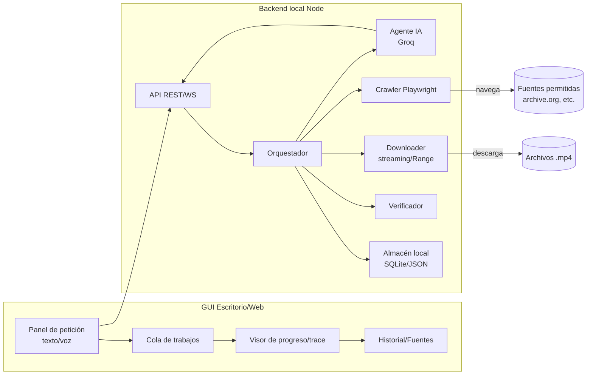

# Especificación — Sistema de GUI + Agente IA para buscar y descargar películas

> Estado: Borrador de especificación (v1)
> Alcance: producto de escritorio/web con interfaz gráfica donde el usuario pide, en lenguaje natural, que un agente IA navegue la web (Catálogo Public Cinema + fuentes de dominio público/CC), localice una película concreta y la descargue.

---

## 1. Resumen ejecutivo

Construir una aplicación con **GUI** que permita al usuario describir la película que quiere (por texto o voz) y que un **agente IA** la **busque navegando** por fuentes legales (Internet Archive y similares), **valide** que es la correcta (título, año, duración, licencia), y la **descargue** con progreso, reanudación y verificación. El sistema debe apoyarse en IA en todo el flujo: comprensión del lenguaje, planificación de la navegación, extracción y verificación de datos, recuperación ante errores y recomendaciones.

La app debe mantener el principio de **coste cero** del proyecto actual: la IA se ejecuta con **Groq** (nivel gratuito) y el control del navegador con **Playwright**; no se usan servicios de pago.

---

## 2. Objetivos y no-objetivos

### Objetivos
- GUI clara para pedir una película por texto o voz y ver el progreso.
- Agente que **navega** de forma autónoma (Playwright) para localizar la película.
- **Verificación** de identidad de la película (título/año/duración) con IA.
- Descarga robusta (streaming, reanudación, cola, verificación de integridad).
- Amplias funciones de IA (ver §5).
- Coste 0 (Groq free tier) y ejecución local.

### No-objetivos (v1)
- Distribución/instalación masiva (v1 es app local).
- DRM o contenido no legal: solo fuentes públicas/CC.
- Indexar toda la web: se limita a fuentes permitidas configurables.
- Cuenta de usuario/servidor central (v1 local; v2 opcional).

---

## 3. Personas y casos de uso

- **Cinephile**: "Busca *Metropolis* de 1927 y descárgala".
- **Explorador**: "Encuentra una película de terror de dominio público de menos de 90 min".
- **Investigador**: "Descarga 3 cortos de animación Creative Commons de los 2000s".
- **Usuario con prisa**: pega una URL de archive.org y pide "descarga esto".

Historias de usuario (muestra):
- Como usuario, quiero describir la película con mis palabras para no tener que buscar manualmente.
- Como usuario, quiero ver el progreso y poder cancelar/reanudar.
- Como usuario, quiero que el agente me pregunte si hay ambigüedad (varias versiones).
- Como usuario, quiero confiar en que se descarga la película correcta y con licencia válida.

---

## 4. Requisitos funcionales (RF)

| ID | Requisito | Prioridad |
| :-- | :-- | :-- |
| RF-1 | Entrada por **texto** de la petición de película. | Alta |
| RF-2 | Entrada por **voz** (Web Speech API) que rellena la petición. | Media |
| RF-3 | El agente **navega** con Playwright para buscar en fuentes permitidas. | Alta |
| RF-4 | **Verificación** de coincidencia (título, año, duración, idioma) con criterio IA + heurístico. | Alta |
| RF-5 | **Descarga** con streaming, barra de progreso y % por archivo. | Alta |
| RF-6 | **Cola** de descargas con estados (encolada, buscando, descargando, pausada, error, hecha). | Alta |
| RF-7 | **Pausa/Reanudar/Cancelar** por trabajo. | Alta |
| RF-8 | **Reanudación** de descargas interrumpidas (HTTP Range / .part). | Media |
| RF-9 | **Verificación estructural** (Content-Length + firma de contenedor). **Sin hash.** | Media |
| RF-16 | **Capturas de pantalla** del navegador (Playwright) por paso, visibles en la UI y usadas por IA-6. | Alta |
| RF-17 | **Tour de onboarding** integrado (driver.js) para uso inmediato. | Alta |
| RF-18 | **Paralelismo** de descargas con pool configurable (defecto 2). | Alta |
| RF-10 | Ante **ambigüedad**, el agente propone candidatos y el usuario elige. | Alta |
| RF-11 | **Historial** de búsquedas/descargas con filtros. | Media |
| RF-12 | **Fuentes** configurables (allowlist) y gestión de nuevas fuentes. | Media |
| RF-13 | **Exportar** informe (JSON/CSV) de la sesión. | Baja |
| RF-14 | **Modo headless** y opción de ver el navegador. | Media |
| RF-15 | **Registro** de pasos del agente (trace) visible en UI. | Media |

---

## 5. Requisitos de IA (IA)

| ID | Capacidad | Descripción |
| :-- | :-- | :-- |
| IA-1 | **Comprensión de la petición** | Extrae intención, título, año, director, duración, idioma, licencia y restricciones desde lenguaje natural (Groq, salida JSON). |
| IA-2 | **Planificador de navegación** | Decide la secuencia de acciones del navegador (ir a fuente, buscar, filtrar, abrir detalle) y la replanifica si falla. |
| IA-3 | **Verificador de identidad** | Compara candidatos (título, año, duración, metadatos) y puntúa la coincidencia; resuelve "¿es esta? ". |
| IA-4 | **Resolución de ambigüedad** | Genera preguntas de aclaración cuando hay múltiples versiones (p. ej. 1968 vs 1990). |
| IA-5 | **Extracción estructurada** | De páginas (título, año, duración, licencia, enlaces de descarga) a JSON validado. |
| IA-6 | **Visión** | Interpreta las **capturas de Playwright** (consentimientos/CAPTCHA ligeros, selectores cambiantes) con el modelo de visión de Groq cuando esté disponible. |
| IA-7 | **Recuperación de errores** | Ante 404/cambios de layout/consent, replanifica (otra fuente, otra versión, esperar/reintentar). |
| IA-8 | **Recomendador** | Sugiere alternativas si no se encuentra (mismo título en otra fuente, edición similar). |
| IA-9 | **Resumen y trazabilidad** | Explica en lenguaje natural qué hizo y por qué (auditable). |
| IA-10 | **Ranking de resultados** | Ordena candidatos por relevancia/licencia/calidad/fuente. |
| IA-11 | **Normalización de títulos** | Corrige transliteraciones, años y variantes de título. |
| IA-12 | **Política de licencias** | Clasifica y respeta licencias (dominio público/CC); evita fuentes no permitidas. |

> Todas las llamadas de IA usan **Groq** con salida JSON y `temperature` baja. Si no hay `GROQ_API_KEY`, el sistema degrada a heurísticas deterministas (IA-1/IA-3/IA-5 con reglas).

---

## 6. Arquitectura



### Componentes
- **GUI** (Electron o Tauri; o web local): petición, cola, progreso, historial, fuentes, ajustes.
- **Backend/Orquestador** (Node): expone API, gestiona cola y ciclo de vida de trabajos.
- **Agente IA** (Groq): IA-1..IA-12; produce planes y decisiones en JSON.
- **Crawler** (Playwright headless): ejecuta el plan, extrae y devuelve candidatos.
- **Downloader**: streaming a disco, Range/reanudación, hash, progreso.
- **Verificador**: puntúa candidatos y decide aceptar/rechazar/aclarar.
- **Almacén**: SQLite (jobs, eventos, fuentes) + archivos.

### Flujo principal
1. Usuario pide película (texto/voz).
2. IA-1 normaliza y extrae criterios.
3. Planificador (IA-2) genera plan; Crawler navega fuentes permitidas.
4. IA-5 extrae candidatos; IA-3/IA-10 puntúan.
5. Si hay ambigüedad → IA-4 pregunta; si no, el mejor candidato pasa.
6. Downloader descarga (streaming, progreso, Range).
7. Verificador (IA-3 + integridad) confirma; se marca hecho.
8. IA-9 resume; se registra en historial.

---

## 7. Modelo de datos (entidades)

- **Movie**: `id, title, year, director, duration_min, genres[], license, source, url, poster_url, quality`.
- **Source**: `id, name, base_url, allowed, kind(PublicDomain|CC|Mixed), selectors_version`.
- **Job**: `id, query_raw, criteria(json), status, progress, file_path, error, created_at`.
- **Candidate**: `job_id, movie_id, score, reasons(json), chosen`.
- **AgentEvent**: `job_id, ts, kind(plan|action|observation|decision), payload(json)`.
- **Settings**: `model, headless, max_parallel, idle_timeout, allowed_sources[]`.

---

## 8. Contratos de API (borrador)

### REST
- `POST /jobs` → crea trabajo.
  ```json
  { "query": "Busca Metropolis de 1927", "voice": false }
  ```
- `GET /jobs` / `GET /jobs/:id` → estado y progreso.
- `POST /jobs/:id/cancel` · `POST /jobs/:id/pause` · `POST /jobs/:id/resume`.
- `GET /jobs/:id/events` → trace del agente.
- `GET /sources` · `POST /sources` · `DELETE /sources/:id`.
- `GET /settings` · `PUT /settings`.

### WebSocket
- `job.update` `{id,status,progress,speed,eta}`.
- `job.candidate` `{id,candidates[]}` (ambigüedad).
- `job.decision` `{id,chosen,reason}`.
- `job.done` `{id,file,bytes,hash}`.

### Ejemplo de salida del agente (JSON)
```json
{
  "criteria": {"title":"Metropolis","year":1927,"license":"Public Domain"},
  "plan": [
    {"action":"goto","url":"https://archive.org/advancedsearch.php?q=..."},
    {"action":"extract","selector":"..."},
    {"action":"open","candidate":0}
  ],
  "candidates": [
    {"title":"Metropolis (1927)","year":1927,"duration":153,"license":"Public Domain","score":0.94,"url":"..."}
  ]
}
```

---

## 9. Especificación de UI

Pantallas:
1. **Petición**: caja de texto + botón micrófono (voz), chips de filtros (año, duración, licencia, idioma), botón "Buscar y descargar".
2. **Cola/Trabajos**: tarjetas con estado, progreso (barra), velocidad, ETA, acciones (pausar/cancelar/reanudar).
3. **Detalle de trabajo**: trace del agente (pasos), candidatos con puntuación, elección si hay ambigüedad, metadatos y licencia.
4. **Historial**: tabla con filtros y exportación.
5. **Fuentes**: lista allowlist, alta/baja, kind.
6. **Ajustes**: modelo Groq, headless, paralelismo, timeouts, clave (`.env`).

Estados y retroalimentación:
- Skeletons durante "buscando"; barra y % en "descargando"; mensajes claros de error con acción sugerida.
- Accesibilidad: foco visible, navegación por teclado, contraste, ARIA en controles.

Wireframe (texto):
```
[ Petición: (texto)  (mic)  Filtros: año|duración|licencia ]  [Buscar y descargar]
[ Cola:  #12 Metropolis 1927  [####--] 62%  4.2MB/s  ETA 1m   [pausar][cancelar] ]
[ Detalle: trace | candidatos (score) | licencia | metadatos ]
```

---

## 10. Requisitos no funcionales (RNF)

- **Rendimiento**: búsqueda inicial < 10 s (dependiente de la fuente); streaming sin cargar en memoria; paralelismo configurable (defecto 2).
- **Robustez**: reintentos con backoff; timeout por inactividad (no total); limpieza de `.part` al fallar.
- **Seguridad**: allowlist de dominios; validación de URL; sin ejecución de JS de terceros (Playwright aislado); `.env` no versionado.
- **Privacidad**: todo local; la IA solo recibe texto de la petición y metadatos (no archivos).
- **Coste**: Groq free tier; sin llamadas de pago; caché de resultados.
- **Compatibilidad**: Windows/macOS/Linux; Node 18+; Playwright Chromium.
- **Observabilidad**: logs por trabajo, trace exportable.

---

## 11. Stack propuesto

- **GUI**: **web local** (Vite + React) servida por el backend en `http://127.0.0.1:<puerto>`.
- **Backend/Agente**: Node.js + **Express + ws** + Playwright (headless) + Groq (OpenAI-compatible).
- **Persistencia**: almacén JSON local (jobs, eventos, fuentes) + archivos; cola y pool en memoria.
- **Tiempo real**: WebSocket (`ws`).
- **Tour**: **driver.js**.
- **Empaquetado**: `npm run app` (build del frontend + arranque del backend); `CRAWLER_*` y `GROQ_*` por `.env`.

---

## 12. Manejo de errores y recuperación

- **404 / fuente caída** → IA-7 elige otra fuente o versión; si no, sugiere alternativas (IA-8).
- **Ambigüedad** → IA-4 pregunta; el usuario elige; se aprende la preferencia (local).
- **Corte de red** → reanudación por Range; reintentos con backoff.
- **Cambios de layout** → selectores versionados + IA-5/IA-6; se degrada a heurística.
- **Licencia no permitida** → se rechaza y se busca alternativa permitida.

---

## 13. Hitos (roadmap)

- **M1**: CLI actual → envolver en API + cola (sin GUI).
- **M2**: GUI mínima (petición + cola + progreso) sobre la API.
- **M3**: IA-1/IA-2/IA-3 con Groq; verificación y ambigüedad.
- **M4**: Reanudación, integridad, historial, fuentes.
- **M5**: Voz, exportación, empaquetado y pulido de accesibilidad.

---

## 14. Criterios de aceptación (ejemplos)

- Dado "descarga Metropolis de 1927", el sistema localiza un candidato con licencia válida y lo descarga con progreso y hash verificado.
- Si hay dos versiones, muestra candidatos con puntuación y pide elección antes de descargar.
- Si la fuente falla, replanifica y lo explica en el trace.
- La descarga se reanuda tras un corte sin empezar de cero.
- Sin `GROQ_API_KEY`, el flujo funciona con heurísticas y lo indica.

---

## 15. Decisiones (resueltas)

- **GUI**: web local (Vite + React) servida por el backend.
- **Ramas**: rama única `feature/agent-gui` con commits descriptivos por componente.
- **Paralelismo**: sí, pool configurable (defecto 2).
- **Fuentes**: **allowlist** gestionable; el agente no navega fuera de la allowlist.
- **Integridad**: **sin hash**; verificación estructural + IA-3.
- **Screenshots**: Playwright captura por paso (usadas por IA-6 y mostradas en UI).
- **Tour**: onboarding con driver.js; UX muy fácil.
- **Voz**: Web Speech API (Chrome/Edge), gratis.